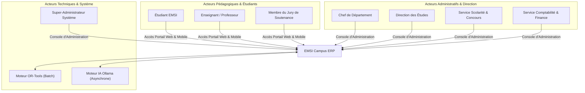

# RAPPORT D'AUDIT TECHNIQUE ET CONTEXTUEL DU PROJET (PHASE A)

> Complément du 11 novembre 2026 : les constats et corrections vérifiés des parcours Responsable planning sont documentés dans [la réorganisation des ressources et du planning](reorganisation-planning-2026-11-11.md). Les sections historiques ci-dessous restent conservées ; elles ne constituent pas une preuve du fonctionnement actuel de chaque module.

**Projet :** EMSI Campus ERP (Univora) — Système Intégré de Gestion Universitaire & Campus Intelligent  
**Établissement :** École Marocaine des Sciences de l'Ingénieur (EMSI Marrakech — Campus Guéliz & Targa)  
**Encadrement :** Pr. ZGANDRI (Encadrante Académique), Pr. AIT OUNEJJAR Lahoussaine (Président de Jury)  
**Auteurs :** Équipe d'Ingénierie PFA (Élèves-Ingénieurs 5ème Année D2SI / IIR)  
**Date d'audit :** 28 Octobre 2026  
**Référentiel :** Skill `project-context-audit`  

---

## 1. Résumé Exécutif

L'audit technique réalisé sur l'espace de travail `c:\Users\hp\Documents\Emsi-project` dresse un état des lieux exhaustif des artefacts existants, de la maturité du projet, des composants techniques validés et des risques structurels.

Le projet a pour ambition de concevoir et déployer un **ERP académique nouvelle génération** unifiant la gestion pédagogique, administrative, financière et logistique des campus de l'EMSI (en commençant par Marrakech : Guéliz et Targa), avec une architecture extensible vers Casablanca et Rabat, et évolutive vers un modèle SaaS multi-tenant pour l'enseignement supérieur privé en Afrique et dans la région MENA.

### Classification Épistémique Globale
- **Artefacts Documentaires & Spécifications :** `[VERIFIED]` Présents, exhaustifs, structurés (Cahier des charges Markdown, Spécification Latex/Overleaf, Document Word `.docx`, Rapport exécutif HTML, Diagrammes HD).
- **Implémentation Applicative (Code Source Backend/Frontend) :** `[UNKNOWN / PROPOSED]` L'espace de travail actuel contient l'ingénierie préliminaire complète et les spécifications techniques mais ne dispose pas encore de code source applicatif Java/Spring Boot ou Flutter/React implémenté dans le dépôt racine.
- **Runtimes & Environnement Système Local :** `[VERIFIED]` Python 3.14 (`py.exe`), Node.js v24.15.0, Java JDK 21 LTS (`C:\Program Files\Java\jdk-21`), Navigateur Chromium Edge Headless installés et opérationnels sur la machine hôte Windows.

---

## 2. Inventaire et Cartographie des Fichiers Détectés

| Chemin Relatif du Fichier / Dossier | Nature de l'Artefact | Statut Épistémique | Observation & Rôle |
| :--- | :--- | :--- | :--- |
| `cahier_des_charges_emsi_campus.md` | Spécification Métier (730 lignes) | `[VERIFIED]` | Description exhaustive des 7 modules fonctionnels, règles métier fondamentales, stack cible et KPIs. |
| `session_analysis_report.md` | Diagnostic de Cadrage PFA | `[VERIFIED]` | Analyse des irritants historiques d'EMSI, méthodologie Scrum+XP, analyse des causes racines. |
| `cahier_des_charges_exact_template.html` | Restitution Interactive Web | `[VERIFIED]` | Dashboard de présentation exécutive pour soutenance et vulgarisation client/direction. |
| `cahier_des_charges_latex/` | Source Typographique LaTeX | `[VERIFIED]` | Projet Overleaf complet (`main.tex`, `styles.sty`, `biblio.bib`) mentionnant Pr. ZGANDRI. |
| `cahier_des_charges_latex.zip` | Archive Déployable LaTeX | `[VERIFIED]` | Package autonome prêt à compiler pour Overleaf ou TeX Live. |
| `Cahier_des_charges_EMSI_Campus_Template_Exact.pdf` | Document PDF Officiel (24 pages) | `[VERIFIED]` | Rendu final paginé avec en-têtes EMSI, sommaire dynamique, tableaux et livrables. |
| `Cahier_des_charges_EMSI_Campus.docx` | Document Bureautique Word | `[VERIFIED]` | Document formatté éditable destiné aux services administratifs et relecteurs. |
| `assets/emsi_logo.png` | Identité Visuelle | `[VERIFIED]` | Logo officiel haute résolution de l'École Marocaine des Sciences de l'Ingénieur. |
| `assets/diagram_1_project_tree_structure.png` | Architecture Système | `[VERIFIED]` | Diagramme arborescent généré représentant les composants et dossiers. |
| `assets/diagram_2_system_architecture_5layers.png` | Schéma Fonctionnel en Couches | `[VERIFIED]` | Vue 5 couches (Présentation, Passerelle, Métier, Persistance, Services Transverses). |
| `assets/diagram_3_database_erd_modules.png` | Modèle de Données | `[VERIFIED]` | Schéma relationnel représentant les modules Utilisateurs, Scolarité, Planning, Examens, Finance. |
| `assets/diagram_4_workflow_seance_soutenance.png` | Flux Opérationnel | `[VERIFIED]` | Diagramme de processus dynamique : déroulement d'une séance et cycle PFE. |
| `.agents/skills/` | Pack d'Ingénierie Logicielle | `[VERIFIED]` | Répertoire contenant les 8 compétences standardisées (audit, UML, architecture, base, UI, sécurité, validation). |

---

## 3. Analyse de la Stack Technique Cible vs Environnement Détecté

### 3.1. Environnement Hôte Détecté (Machine Locale)
- **Système d'Exploitation :** Windows 10/11 x64.
- **Java :** JDK 21 LTS (`openjdk 21 2023-09-19`, `C:\Program Files\Java\jdk-21\bin\java.exe`). Compatible avec Spring Boot 3.3+.
- **Node.js :** v24.15.0 (`C:\Program Files\nodejs\node.exe`). Compatible avec Next.js 14/15, Tailwind CSS, et tooling frontend moderne.
- **Python :** Python 3.14 via `py.exe` avec bibliothèques `python-docx`, `pypdf`, `pillow`.
- **Docker / Orchestration :** `[INFERRED]` Environnement cible de virtualisation en conteneurs pour PostgreSQL 16, Redis 7, MinIO et Ollama.

### 3.2. Stack Technique Cible Spécifiée (To-Be)
- **Backend Core :** Java 21, Spring Boot 3.3, Spring Data JPA, Spring Security (OAuth2/JWT), Hibernate 6.
- **Frontend Web Portal :** React 19 / Next.js 15 (App Router), TypeScript, Tailwind CSS, Shadcn/UI, Lucide Icons.
- **Application Mobile :** Flutter 3.24+ (Dart 3), Riverpod, Architecture Offline-First (Isar / Hive) pour étudiants et enseignants.
- **Moteur d'Optimisation :** Google OR-Tools (Solver CP-SAT) encapsulé en microservice Python (FastAPI) ou bibliothèque native Java JNI pour la génération d'emplois du temps sans conflits.
- **Intelligence Artificielle Locale :** Ollama orchestrant le modèle Llama 3.2 (3B) pour le matching sémantique des mémoires PFE et la synthèse des cours, hébergé localement garantissant la confidentialité des données (zéro fuite vers OpenAI/Google).
- **Persistance & Caching :** PostgreSQL 16 (Schémas partitionnés ou isolation par `tenant_id`), Redis 7.2 (gestion des sessions, rotation QR codes, cache temps-réel), MinIO (Stockage objet S3 on-premise pour les documents et PFE).

---

## 4. Analyse des Acteurs, Rôles et Frontières du Système

L'analyse des spécifications fait émerger sept rôles d'acteurs primaires et secondaires interagissant avec la plateforme :

### Périmètre d'Autorisation par Rôle
1. **Étudiant (`ROLE_STUDENT`) :** Consultation de l'emploi du temps dynamique, pointage par scan de QR code éphémère (15s), consultation des notes et crédits après délibération, téléchargement des supports de cours, soumission du rapport de PFE et suivi du statut d'approbation.
2. **Professeur (`ROLE_PROFESSOR`) :** Génération et affichage du QR code de présence, saisie du cahier de texte numérique déclenché par notification à la fin du cours, saisie des notes d'évaluation continue et d'examens finaux, validation des jalons de stage PFE.
3. **Chef de Département (`ROLE_DEPT_HEAD`) :** Paramétrage de la maquette pédagogique (modules, éléments, coefficients), validation des contraintes d'emploi du temps, organisation des sessions de délibération, supervision des affectations de stages PFE.
4. **Direction des Études (`ROLE_ACADEMIC_DIR`) :** Validation finale des procès-verbaux (PV) de délibération, publication officielle des résultats de fin d'année, arbitrage des transferts inter-campus (Guéliz <-> Targa).
5. **Service Scolarité (`ROLE_REGISTRAR`) :** Gestion des inscriptions, délivrance des attestations de scolarité avec QR code de vérification cryptographique, gestion des dossiers étudiants et absences justifiées.
6. **Service Financier (`ROLE_FINANCE`) :** Facturation des frais de scolarité, enregistrement des règlements (chèques, virements, paiements en ligne), déclenchement des blocages administratifs d'attestations en cas de retard $> 10$ jours ouvrés.
7. **Super-Administrateur (`ROLE_SUPER_ADMIN`) :** Gestion multi-tenant, configuration des campus, gestion des utilisateurs et rôles, supervision des métriques système et consultation des logs d'audit immuables.

---

## 5. Règles Métier et Invariants Fondamentaux Détectés

L'analyse minutieuse des spécifications met en exergue sept règles métier absolues, dont la violation provoquerait un échec fonctionnel ou réglementaire :

1. `RULE-GEO-01` (Transit Inter-Campus) : Un délai de battement incompressible de **45 minutes** doit séparer deux séances consécutives pour un même enseignant ou groupe d'étudiants lorsqu'il y a changement de site entre Guéliz et Targa.
2. `RULE-ATT-02` (Émargement par QR Code Éphémère) : Le QR code projeté par le professeur est régénéré automatiquement toutes les **15 secondes** à l'aide d'un jeton cryptographique à usage unique (HMAC-SHA256) validé côté serveur via Redis. Le scan étudiant doit coïncider avec une fenêtre d'horodatage stricte et la localisation du campus.
3. `RULE-NOT-03` (Cahier de Texte Temps-Réel) : À la fin exacte de chaque séance ($T_{fin}$), une notification push urgente est envoyée sur le mobile de l'enseignant l'invitant à renseigner le contenu pédagogique et les devoirs assignés.
4. `RULE-DELIB-04` (Zéro Excel & Seuil Éliminatoire) : Les délibérations sont calculées en temps réel selon la formule pondérée officielle. Une note inférieure à **7.00/20.00** à l'examen final constitue une **note éliminatoire automatique**, invalidant le module indépendamment de la moyenne du contrôle continu.
5. `RULE-AI-05` (Matching PFE & Souveraineté des Données) : L'appariement des mémoires de PFE avec les compétences des jurys est calculé par similarité cosinus ($> 0.70$) sur les embeddings vectoriels générés localement par Ollama (Llama 3.2), sans aucune dépendance vers un cloud externe.
6. `RULE-FIN-06` (Verrouillage Administratif Conditionnel) : Tout retard de paiement des frais de scolarité supérieur à **10 jours ouvrés** applique un verrouillage automatique sur la génération et le téléchargement des attestations officielles et relevés de notes.
7. `RULE-SEC-07` (Traçabilité CNDP / Loi 09-08) : Toute consultation de dossier sensible, modification de note post-délibération ou action financière est journalisée de manière immuable dans `audit_logs` avec l'adresse IP, le `user_id`, l'empreinte avant/après et l'horodatage NTP.

---

## 6. Analyse des Risques et Dette Technique Pré-Conception

| Risque Identifié | Impact | Probabilité | Mesure d'Atténuation Validée |
| :--- | :---: | :---: | :--- |
| **Complexité combinatoire du solveur d'emploi du temps** | Élevé | Élevée | Découplage asynchrone du solveur OR-Tools avec exécution en arrière-plan via RabbitMQ/Redis Queue et timeout plafonné à 180s. |
| **Fraude à l'émargement (partage de capture d'écran du QR)** | Élevé | Moyenne | Token éphémère de 15s + géolocalisation de l'appareil mobile + contrôle de device_id unique par étudiant. |
| **Conflits de délibération lors d'éditions concurrentes de notes** | Critique | Moyenne | Verrouillage pessimiste (`PESSIMISTIC_WRITE`) sur la table des notes lors du gel officiel de la session de délibération. |
| **Surcharge des GPU/CPU lors de l'inférence Ollama** | Moyen | Moyenne | File d'attente FIFO asynchrone pour les embeddings PFE, exécutée hors heures de pointe de délibération. |
| **Isolement défaillant des données multi-campus/multi-tenant** | Critique | Faible | Filtrage automatique à l'aide d'un intercepteur Hibernate injectant `WHERE tenant_id = current_tenant` sur chaque requête. |

---

## 7. Conclusion et Plan de Transition vers la Phase B

L'état des lieux confirme que le domaine métier est parfaitement délimité, documenté et mathématiquement formalisé.  
L'absence de code applicatif legacy au profit d'un cahier des charges rigoureux constitue un atout majeur : il permet d'adopter une **approche Clean Architecture / DDD (Domain-Driven Design)** exempte de dette technique préalable.

La phase suivante (**Phase B : Ingénierie des Exigences**) formalisera le catalogue exhaustif des exigences fonctionnelles (`FR-001` à `FR-020+`), des exigences non fonctionnelles (`NFR-001` à `NFR-010+`), du référentiel des règles métier (`BR-001` à `BR-015+`), des cas d'utilisation détaillés (`UC-001` à `UC-010+`) et de la matrice de traçabilité complète.
